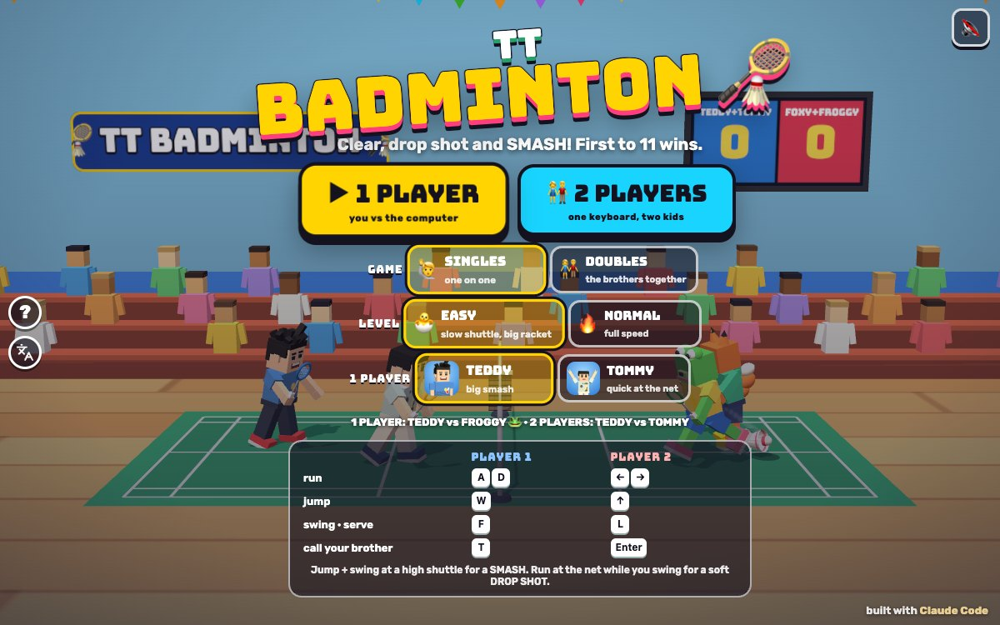

# TT Badminton

Press **?** any time (or tap the round **?** button on the left edge) to see the keys. The game waits while you look.
Tap the language button under it (the A文 icon) to switch between English and 中文; the dashboard and every game remember the choice.

**中文：** 体育馆里的横版羽毛球：高远球、吊球和跳起来扣杀，羽毛球飞得像真的一样。单打或双打，Teddy 和 Tommy 对 🐸 Froggy 和 🦊 Foxy，也可以兄弟俩对打。先得 11 分就赢。

Side-view badminton in a sports hall: clears, drop shots and jumping smashes with a shuttle that really flies like one. Singles or doubles, Teddy and Tommy against 🐸 Froggy and 🦊 Foxy, or against each other. First to 11 wins.

A badminton game starring Teddy and Tommy, built with Claude Code from plain JavaScript and Three.js on the shared Claude Games kit. There are no image, model or audio files: the players are the kit's blocky characters (Foxy and Froggy are built on the kit's bear head), the hall, the court lines, the net and the shuttlecock are painted on canvases or built from boxes and cones, and every sound is synthesised.

The name lives in one place, `BT_TITLE` in `js/title.js`; the page title, the logo, the hall's banner and the ? panel read it from there.

## Play

- **Double-click `index.html`.** It works offline because Three.js and the kit are copied into `kit/`. Without internet the title font falls back to Arial Black.
- **Send one file:** `dist/badminton-tt.html` is the whole game in one page. AirDrop or email it, then open it in a browser.
- Rebuild that file after any edit: `python3 kit/tools/bundle.py . --name badminton-tt`

The title screen has **▶ 1 PLAYER** and **👫 2 PLAYERS**, and three settings that are remembered:

- **GAME:** 🙋 **SINGLES** (one on one) or 👫 **DOUBLES** (the brothers on one side).
- **LEVEL:**
  - **🐣 EASY** (the default), for Tommy (5): the shuttle flies at three quarters speed, your racket reaches further and stays live longer, you drift toward the shuttle by yourself when you let go of the keys, and a yellow ring shows where it will land. You play 🐸 **Froggy**, who is a bit slow, makes mistakes, and often hits it back to you.
  - **🔥 NORMAL**, for Teddy (8): full speed, no drifting, no ring. You play 🦊 **Foxy**, who runs faster, places the shuttle away from you, drops it short when you're at the back, and smashes high ones.
- **1 PLAYER:** play as **Teddy** or **Tommy**.

Who plays whom (the line under the settings says it too):

| | Singles | Doubles |
|---|---|---|
| **1 player** | you vs Froggy (EASY) or Foxy (NORMAL) | you and your brother (the computer plays him) vs Foxy and Froggy |
| **2 players** | Teddy (player 1) vs Tommy (player 2) | Teddy and Tommy together vs Foxy and Froggy |

In doubles Teddy plays the back of the court and Tommy the front, by the net.

## How to hit

Press swing and the racket is live for a moment. Where the shuttle is when you meet it picks the shot, and the game aims it into the other court for you:

| Shot | How | What it does |
|---|---|---|
| **SMASH** | jump (W / ↑ / ⤒) and swing at a high shuttle | fast and steep. Teddy smashes from his 🏀 jump-shot pose |
| **CLEAR** | swing at a high shuttle without jumping | high and deep, to the back of their court |
| **DRIVE** | swing at chest height | flat and quick |
| **LIFT** | swing at a low shuttle | high and deep, to get you out of trouble |
| **DROP SHOT** | run toward the net while you swing at a high one | soft, just over the net |
| **NET SHOT** | run toward the net while you swing at a low one | a little tumble over the tape |

Serves are underhand: press swing to serve high and deep, or run at the net while you press it for a short serve. If a kid wanders off, the serve goes by itself after 6 seconds.

## Rules

- **Rally scoring:** every rally gives a point, and whoever wins it serves next. In doubles the partners take turns serving.
- **First to 11 wins**, but you have to be 2 ahead (10–10 plays on), and 15 always wins. "GAME POINT" shows when one more point ends it.
- A rally ends when the shuttle lands: in the other court (point to the hitter), past the back line (OUT!, point to the other side; kid rules let a landing 15 cm past the line count), or into the net or short on your own side.
- The computer lets a shuttle that's flying out drop, like a real player. Froggy sometimes plays it anyway.

## Controls

| | Player 1 | Player 2 | Touch (1 player) |
|---|---|---|---|
| run | A D | ← → | hold ◀ ▶ |
| jump | W | ↑ | ⤒ JUMP |
| swing / serve | F | L | 🏸 SWING |
| call your brother | T | Enter | tap his face |

- In 1-player mode both key sets control you, and Space swings too.
- **P** or Esc pauses, and **M** turns the sound on or off. In a game the ❚❚ and 🔊 buttons sit in the middle of the top bar; on the menus the 🔊 button is in the top right corner.
- **Title keys:** Enter or 1 starts 1 player, 2 starts 2 players, ← → switch the level, D switches singles / doubles, and T switches Teddy / Tommy.
- **Results:** Enter plays again, Esc goes to the menu. Pause: P, Esc or Space resumes, Q goes to the menu.
- Two players need a keyboard. On a phone held upright the court is small: a note says to turn it sideways.

## Call your brother (companion mode)

In singles, press **T** (or tap his face, or the chip under your name) any time to call the other brother: Tommy if you're Teddy, Teddy if you're Tommy.

- He pops onto your side of the court at his own (smaller) size, does his signature move (Tommy's ✌️ Y pose, Teddy's boxing), and tosses you a treat (🍦 💧 🧃 🍪 🍉 🍌) that sits over your head for a while.
- Then he **returns one shot for you**: "TOMMY SAYS: I'LL GET THE NEXT ONE!" He runs to the next shuttle that comes to your side and hits a big safe clear ("TOMMY GOT IT!"), even one you'd never reach.
- **Call him as often as you like.** Every call adds one more return (up to 9), and the ×2, ×3 badge on his face shows how many he still owes you. When he's done he waves and pops out.
- When both brothers are playing (doubles, or Teddy vs Tommy), **T is a high five** instead: they both throw a hand up, sparkles, and a clap.

## Winning

The winners do their signature moves (Teddy's 🏀 jump shot, Tommy's ✌️ Y pose, Foxy and Froggy wave), the crowd jumps and confetti flies. Then the results card shows the score, the smashes, the longest rally, and **WINS SO FAR**: the running tally for that pairing on this device. **↻ PLAY AGAIN** starts the same game again.

## How it works, and how it's tested

- `js/rules.js` is the whole game with no Three.js and no page: the shuttle, the shot solver, the players, scoring, the computer friends and the brother's return. The page and the check both run it.
- **The shuttle:** gravity plus air drag that grows with the square of its speed (a = g − (g / VT²)|v|v, terminal speed 7.2 m/s). It leaves the racket fast, slows right down and falls almost straight. The drag is applied implicitly (v ÷ (1 + k|v|dt)), so it can only ever slow the shuttle: it's stable at any speed and time step. EASY runs the shuttle's clock at 0.75, the same flight, just slower to watch.
- **The solver** picks a launch angle from the shot's list and finds the speed by bisection on the real flight, so every shot lands where it was aimed and clears the net. A shot that can't be made from where you met it (a smash from the back wall) falls back to one that can.
- **The computer** predicts the shuttle's path frame by frame, waits its reaction time, picks where to meet it (as high as it can reach in time), runs there, jumps for a smash, and presses swing so the racket is live as the shuttle arrives. Its mistakes (into the net or out) get likelier as a rally goes on, so every rally ends.
- **The headless check** (`node tools/check.js`, about 20 s; also `game.check()` in the browser console):
  - *shuttle physics stable:* 600 random hits from 1 to 60 m/s at every angle: no NaN, the energy never goes up, every one lands within 12 s, the longest goes about 13 m, a drop from 40 m falls at the terminal speed, and a 1/60 s step lands within 0.25 m of a 1/600 s step;
  - *the solver:* about 375 shots of every kind from anywhere a player can reach all land in the other court, and the net and long mistakes really are mistakes;
  - *scoring:* hand-made landings (in, out, short, on the line) give the right point and serve, and 2000 random games match a second scorer written separately (including 10–10 deuces and the 15 cap);
  - *CPU rallies:* whole games between every pair of computer players and a sloppy "kid" bot, singles and doubles, EASY and NORMAL: every game finishes, rallies average at least 3 hits, and both sides win points;
  - *the brother:* called 1, 2 or 3 times in a singles game, he returns that many shots.
- **It can fail:** `node tools/check.js --sabotage drag` (drag that pushes), `--sabotage score` (a game ends at 10) and `--sabotage lazy` (the computer never swings) each make it fail.
- The page was also checked with real keys and taps through Chrome (Enter, F, D, ←, T, P, M, Esc, Q, the 🏸 and brother buttons), in 中文 on every screen (`Kit.lang.untranslated()` was empty), and at 1200×750, 1024×768, 740×360 and 390×844. `node tools/shoot.js` drives headless Chrome for that; `tools/shots.json` makes `docs/screenshot.jpg`.

## Files

| File | What's in it |
|---|---|
| `index.html` | the page: styles, HUD, menus, touch buttons, and the script order |
| `js/title.js` | the game's name |
| `js/friends.js` | Foxy and Froggy (from TT Go) |
| `js/rules.js` | shuttle physics, the solver, scoring, the computer, the brother, the headless check |
| `js/poses.js` | the badminton racket and the swing poses |
| `js/stage.js` | the sports hall, the court, the net, the scoreboard and the crowd |
| `js/fx.js` | the shuttlecock, its trail and shadow, the landing ring, word bursts, feathers, confetti |
| `js/sfx.js` | the game's own synth sounds (through `Kit.sound`) |
| `js/game.js` | the scene, camera, menus, HUD, input, the brother's visit, and the `window.game` test hooks |
| `js/keys.js` | the ? panel |
| `js/zh.js` | 中文 |
| `tools/check.js` | runs the headless check in node |
| `tools/shoot.js` | headless Chrome screenshots and real input |
| `kit/` | the shared kit, copied in with `python3 ../kit/tools/sync.py .` (edit it in `~/claude-games/kit`, never here) |

## Not verified

- Sound: every test ran muted, so nothing was heard; the sounds were only checked in code.
- Real touch devices: taps were tested with emulated touch and real mouse events at phone and iPad sizes, not on a real iPhone or iPad.
- How it plays for the boys: whether EASY is easy enough for Tommy (a simulated kid who only taps swing beats Froggy; a slower one trades points with him), whether Foxy is beatable for Teddy, and whether 11 points is a good length (EASY games run about 5 to 10 minutes).
- Double-click from Finder (the page was opened from file:// in headless Chrome), and the iPad home-screen icon.
